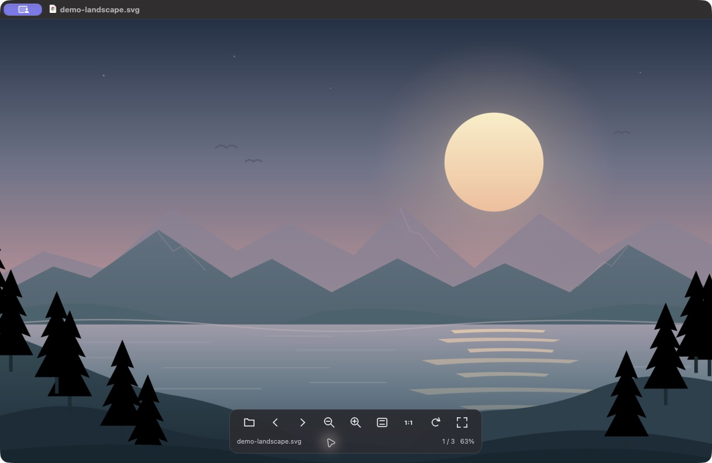
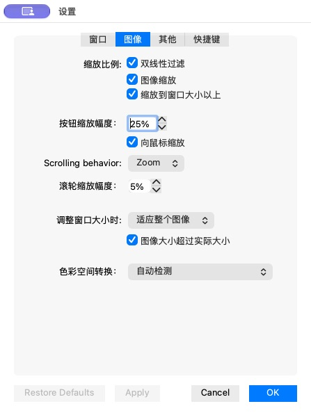
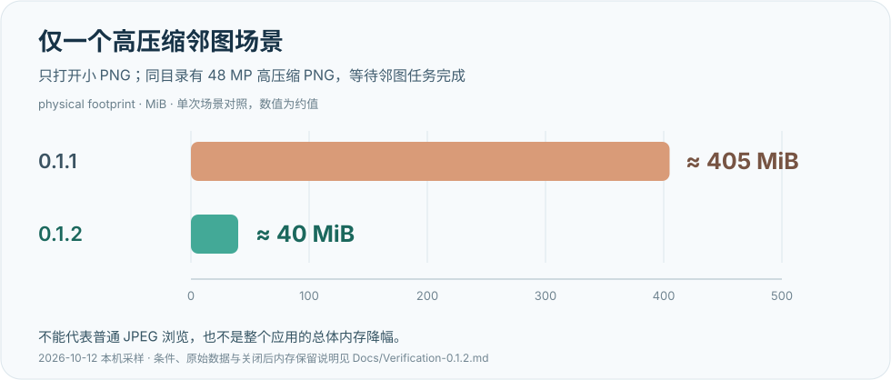

# 轻看 QingView

**打开图片，专心看图。** 轻看是一款面向 Apple Silicon Mac 的本地看图工具，基于成熟的 [qView 7.1](https://github.com/jurplel/qView/tree/7.1) 改进，保留简洁的浏览体验，加入中文界面、细调滚轮缩放与浮动工具栏。

无需账号，无广告，无订阅。图片直接从本地文件夹读取，应用不提供网络图片下载，也不发起自动更新检查。

**Apple Silicon arm64 · macOS 12+ · 当前版本 0.1.2 · GPLv3**

[下载 0.1.2](https://github.com/RGB-hengzhi/QingView/releases/tag/v0.1.2) · [使用说明](#使用与快捷键) · [功能与资源实测](Docs/Verification-0.1.2.md) · [许可证](LICENSE)



*实际应用截图；画面使用仓库内的[原创纯 SVG 演示图](Docs/assets/demo-landscape.svg)，没有使用第三方照片。*

## 能做什么

- **打开一张图，浏览整个文件夹。** 支持拖入、本地文件粘贴、Finder「打开方式」，以及「文件 → 打开文件夹」。文件名按 `1、2、10` 自然排序，不建立图库、不扫描子目录。
- **缩放细一点。** 滚轮默认每格约 5%，可在设置中调整为 1%—50%；细小滚动按比例累积，正反滚动互逆。工具栏和键盘缩放的默认步长仍为 25%，也支持触控板开合与拖动平移。
- **控制栏需要时出现。** 底部提供前后张、缩放、适应窗口、100%、旋转和全屏。移开后约两秒隐藏，停在按钮或文字区域时保持显示，不挤占图片布局。
- **常用操作保留。** 文件信息、镜像/翻转、GIF 播放/暂停/逐帧、幻灯片、最近文件、多窗口、重命名、移到废纸篓及撤销。
- **显示旋转，保留原图。** 旋转、镜像与翻转作用于当前显示，不把变化写回文件；重命名和移到废纸篓则是真实文件操作。
- **资源开销有明确边界。** 相邻图片预读按解码尺寸预算，跳过超预算邻图；关闭最后一个图片窗口清空解码缓存。大图仍需要与像素数量相应的内存。



## 下载与安装

1. 在 [v0.1.2 Release](https://github.com/RGB-hengzhi/QingView/releases/tag/v0.1.2) 下载 `QingView-0.1.2-arm64.zip`。
2. 解压后，将 `轻看.app` 拖入「应用程序」文件夹，再双击打开。
3. 拖入图片，或用 `⌘O` 打开图片、`⌘⇧O` 打开图片文件夹。

当前发行包仅提供 **Apple Silicon（M 系列）arm64**，最低部署目标为 macOS 12；尚无 Intel 发行包。原生界面与资源实测主要在 macOS 27.0.1 完成，其他系统版本的兼容性反馈欢迎提交 Issue。

### 首次打开时的系统提示

0.1.2 使用本地 ad-hoc 签名，**尚未使用 Developer ID 签名及 Apple 公证**，因此互联网下载的应用可能被系统拦住。确认文件来自本仓库 Release 后，先尝试打开一次，再进入「系统设置 → 隐私与安全性」，在对应应用提示处选择「仍要打开」，并确认打开。macOS 12 的入口位于「系统偏好设置 → 安全性与隐私」。

这是为单个应用授权的正常系统流程，无需全局关闭 Gatekeeper。详见 [Apple：在 Mac 上安全地打开 App](https://support.apple.com/zh-cn/102445)。

## 使用与快捷键

| 操作 | 默认快捷键或入口 |
| --- | --- |
| 打开图片 | `⌘O` |
| 打开文件夹 | `⌘⇧O` |
| 上一张 / 下一张 | `←` / `→` |
| 第一张 / 最后一张 | `Home` / `End` |
| 放大 / 缩小 | `⌘=` / `⌘−`，或工具栏按钮 |
| 适应窗口 | `⌘0` |
| 原始大小（100%） | `O` |
| 向右 / 向左旋转 | `↑` / `↓` |
| 水平镜像 / 垂直翻转 | `F` / `⌘F` |
| 全屏 / 退出全屏 | 工具栏全屏按钮 / `Esc` |
| 图片信息 | `I` |
| GIF 暂停或继续 / 下一帧 | `P` / `N` |
| 重命名 | `⌘Enter` 或 `F2` |
| 移到废纸篓 / 撤销 | `⌘⌫` / `⌘Z` |
| 复制 / 粘贴本地文件 | `⌘C` / `⌘V` |
| 新建窗口 / 关闭窗口 | `⌘N` / `⌘W` |
| 设置 / 退出应用 | `⌘,` / `⌘Q` |

快捷键可在设置中修改。小键盘或紧凑键盘没有 `Home` / `End` 时，可直接使用菜单。幻灯片在「工具」菜单启动或停止；默认间隔为五秒，可设置方向与间隔。

## 格式与验证范围

最终安装包的独立解码探针完成 **13 项检查，全部通过**。这是检查数量，**不是宣称完整实测了 13 种格式**。

| 输入 | 本次实际验证 |
| --- | --- |
| JPEG | 解码、EXIF 自动方向、6000×4000（24 MP）大图、损坏文件拒绝 |
| PNG | 解码、透明通道、中文文件名 |
| WebP | 静态图片解码 |
| HEIC | 系统 ImageIO 解码、EXIF 自动方向、Display P3 输入转换到 sRGB 的参考像素对照 |
| GIF | 三帧实际解码与颜色变化；播放、暂停、逐帧另有窗口集成验收 |
| SVG | 宽高比、固有尺寸与实际象限像素，由窗口集成验收验证 |

HEIC 当前面向 **sRGB 的 SDR 浏览**，不承诺 HDR 或保留原始 Display P3 显示范围。Qt 插件还能识别其他输入，具体取决于插件和系统；未逐项验证的格式、动画或多页变体不作为这一版本的兼容性承诺。

0.1.2 的真实 Cocoa 窗口回归为 **82 项通过、0 失败、0 跳过**，覆盖解码、自然排序、滚轮、方向变换、全屏、GIF、文件操作、设置、多窗口、异步关闭与缓存边界；原生鼠标悬停、目录选择及安装程序也单独验证。完整条件与限制见 [0.1.2 验证报告](Docs/Verification-0.1.2.md)。

## 资源使用：小图轻，大图按像素付出开销

以下是本机有限场景的观测，单位为 **MiB，指标为 macOS physical footprint**，不是 RSS，也不是跨应用性能排行。

| 0.1.2 实际场景 | 观测值 |
| --- | ---: |
| 已安装程序：小合成图，经历目录选择、翻图与悬停操作 | 45.1 MiB |
| 单张 6000×4000 JPEG，稳定后 | 约 221 MiB |
| 同文件夹 8 张 24 MP JPEG，三轮浏览后 | 约 682 MiB |

默认共享解码缓存预算为 200 MiB，更大预加载模式为 800 MiB；Qt 单图解码分配限制为 512 MiB。这些都不是整个进程的内存硬上限，当前图片、转换、显示和系统库还有额外开销。



上图**只对应一个高压缩邻图场景**：仅打开小 PNG，旁边有一张 48 MP 高压缩 PNG，等待邻图任务结束。预读按解码像素预算后，该场景从约 405 MiB 降至约 40 MiB。普通 JPEG 的同条件观测基本相近：单图约 221 MiB，三轮约 682 MiB，不能把这张图解释为应用所有场景都减少了九成内存。

大图关闭后，macOS 分配器可能继续保留已经释放、可复用的大块内存，footprint 不一定立即下降。本轮另做了 `heap` / `vmmap` 与独立 `malloc/free` 对照，不将系统保留区域直接当作活图片缓冲，也不据此保证所有输入都没有泄漏。测试条件、采样限制与关闭后保留说明见 [资源实测报告](Docs/Verification-0.1.2.md#资源策略) 和 [资源探针说明](tests/RESOURCE.txt)。

## 本地构建

在 Apple Silicon Mac 上准备：

- macOS Command Line Tools（包含 Clang、Swift 与 `make`）。
- Python 3。
- Qt **6.8.3** 的 macOS SDK：Qt Base、Qt SVG、Qt Tools、Qt Image Formats，需包含 `qmake`、`macdeployqt`、`lrelease` 及图片插件。

```sh
git clone https://github.com/RGB-hengzhi/QingView.git
cd QingView

# 按你的实际 Qt 安装位置修改；目录内应有 bin/qmake。
export QINGVIEW_QT_ROOT="$HOME/Qt/6.8.3/macos"
bash scripts/build_app.sh
```

产物位于 `dist/release/轻看.app` 和 `dist/release/轻看-0.1.2-arm64.zip`。脚本默认在内部磁盘的 `$HOME/.cache/qingview-build` 暂存和编译，部署 Qt 框架/插件，裁剪为 arm64，保留许可证，清理 AppleDouble 文件，执行本地签名与校验。可用 `QINGVIEW_BUILD_ROOT` 指定另一处内部 APFS 构建目录。

构建配置已处理新 Clang 的 ARM intrinsic 声明，以及新 macOS SDK 移除 AGL 后的链接兼容问题。历史工程文件名仍为 `qView.pro`；当前发行目标是 macOS arm64，上游遗留的其他平台配置不代表已有对应发行包。构建脚本不执行 Developer ID 公证。

### 运行测试

新克隆不包含生成样本或本机测试结果。以下入口只生成合成图片，包括 Swift 生成的 JPEG/PNG/HEIC/GIF 和 Qt helper 生成的 WebP：

```sh
QT_ROOT="$QINGVIEW_QT_ROOT" bash tests/generate_fixtures.sh
QT_ROOT="$QINGVIEW_QT_ROOT" bash tests/run_integration.sh
```

测试需要已解锁的图形桌面，会创建和关闭自己的窗口。使用临时 INI 设置；重命名与废纸篓测试只操作临时副本；不会移动系统鼠标。结果写入 `tests/results/`。生成器也接受 `QINGVIEW_QT_ROOT`；若同时设置，`QT_ROOT` 优先。用 `QINGVIEW_FIXTURES` 自定义样本目录时，生成和测试需使用同一个值。

- [集成验收说明](tests/INTEGRATION.md)：单项运行、输出与源码快照。
- [格式探针说明](formats/README.md)：解码检查与安装包依赖检查。
- [资源探针说明](tests/RESOURCE.txt)：独立运行资源采样及压力样本，资源测量应与其他 GUI 测试串行。

## 当前还没有

纯截图/位图剪贴板粘贴、缩略图侧栏、专用 RAW/PSD 解码、多页文档浏览，以及裁剪/标注/调色后导出。当前粘贴接受本地文件 URL；旋转与镜像是显示操作。这里优先做好本地图片浏览，没有加入云同步、账号或后台图库扫描。

## 贡献与来源

欢迎通过 [Issues](https://github.com/RGB-hengzhi/QingView/issues) 反馈问题或提出建议。说明轻看版本、macOS、芯片型号、图片格式和复现步骤；能用合成样本重现更便于定位。PR 请保持改动聚焦，并附验证方法。解码、预加载或窗口生命周期的改动，建议复用真实窗口回归。

轻看基于 qView **7.1**，固定上游提交为 `0ec246b78c310d5c842836a91566db24037c75c2`。感谢 jurplel 与 qView 贡献者提供的浏览基础；上游说明保留在 [Docs/README.upstream.md](Docs/README.upstream.md)。

项目及修改沿用 [GNU GPLv3](LICENSE)。[第三方声明](THIRD_PARTY_NOTICES.md) 与 [许可证目录](resources/licenses/) 保留 Qt、Lato、图像库等原始归属和许可；分发时请一并保留。应用图标、工具栏绘制与演示山水 SVG 来自本项目的原创源码。
